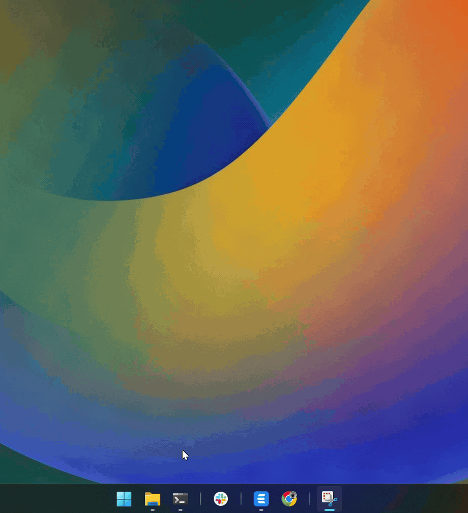
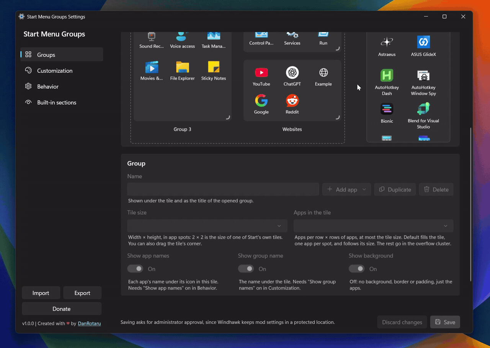

# Start Menu Groups

Add your own **app groups** to the **Windows 11 Start menu**, before or after the Pinned section (or in place of the built‑in **All → View: Category** grid), using the same look as Start: rounded tiles with an icon preview, an overflow cluster for the remaining apps and the group name underneath.

Designed for the Windows 11 Start menu (`StartMenuExperienceHost.exe`).

## Features

- **Your own groups** — create any number of groups and put any Start menu app in them, desktop and Store apps alike. An app can be in several groups.
- **Apps, programs and websites** — each item is a Start app (picked by name or app ID), a program, file or folder (full path with optional arguments), or a website opened in the default browser.
- **Custom names and icons** — every item can have its own label and icon: an `.ico`, `.exe`, `.dll` or image file, an image link (such as a website's favicon), a Fluent icon by its code (e.g. `E774`) or an emoji.
- **Native look** — rounded tiles, borders and colors match Start's own category view and follow the Windows light / dark theme.
- **Resizable tiles** — give each group its own tile size, from 1 × 1 up to 6 × 4 (24 apps). Bigger tiles take more cells of the group grid. A 1 × 1 tile is a single app on its own, without a group.
- **Overflow cluster** — when a group has more apps than fit, the last cell shows the rest as small icons; click it to open the apps that didn't fit.
- **Folders** — put any number of apps in a folder: it takes one cell of the tile, shows its first apps as small icons, and opens like a group when clicked.
- **Right‑click menu** — right‑click an app in a group for **Edit**, **Run as administrator**, **Open file location**, **Pin to taskbar**, **App settings** and **Uninstall**, like Start's own apps.
- **Size presets** — Default, Small and Large presets for the tiles, icons and names, plus control over gaps, corner radius, colors and group names.
- **Placement** — show the groups before or after Pinned, after Recommended / Recent, or after the All section, with an optional section title.
- **Hide Start's sections** — optionally hide Start's own Pinned, Recommended and All sections and use only your groups.
- **Settings window** — right‑click the groups in Start → **Customize Start Groups** for a visual editor with drag & drop (see [Settings window](#settings-window)).
- **Import / export** — all settings can be exported to and imported from a JSON file.

## Screenshots

The settings window, with drag & drop editing of groups and apps:

## Setting it up

Everything is configured on the mod's **Settings** tab in Windhawk, in
sections:

* **Groups** — add a group with *Add new item*, give it a name, a tile size and its items. For a Start app, enter the app's name exactly as it appears in Start (for example `Calculator`, `Visual Studio Code`; case doesn't matter), or its app ID (AUMID, such as `Microsoft.WindowsCalculator_8wekyb3d8bbwe!App`). For a program, its full path (a program, file or folder) and optional arguments; for a website, its address. For a folder, its name (*Label*) and its apps under *Folder apps*. Reorder groups with the arrows.
* **Behavior** — where the groups appear, the section title, app names and tooltips, sorting, empty groups, the number of columns when a group is opened, and hiding Start's own sections.
* **Tiles**, **Icons**, **Group names** — sizes, gaps and colors. The defaults match Start's own category view.

Changes apply to Start as soon as you click **Save settings**.

## Settings window

Right‑click the groups in Start → **Customize Start Groups** (also added to Start's own right‑click menu, after *Start settings*) opens a settings window with the same settings, but easier to edit:

* **Groups** — shows the groups the way Start does. Drag apps to reorder them or move them to another group, drag a tile to reorder the groups, drag a tile's corner to resize it, and drag apps from the All Apps list onto a tile to add them. **Add app → Folder** adds a folder: drop apps onto it to put them in, and double‑click it to open it, then add, reorder or drag apps back out. The selected group and app are edited below the groups. Right‑click a tile to rename, duplicate or delete it.
* **Customization** — the size preset (Default, Small, Large), gaps, corner radius, colors and group names.
* **Behavior** — placement, section title, app names, tooltips, sorting and columns.
* **Built‑in sections** — hide Start's own Pinned, Recommended and All sections.

Start apps are picked by name with suggestions from the apps in Start; programs have a file picker. Groups and items can be duplicated, and an app can be added on its own, without a group. **Import** / **Export** at the bottom of the navigation pane save all settings to, or load them from, a JSON file.

The window is hosted by File Explorer — the mod also loads into `explorer.exe` for this, and does nothing else there — because the Start menu process can't host one. It edits the same settings as Windhawk. Windhawk keeps them in a protected registry key, so **Save** shows an administrator (UAC) prompt for Windows PowerShell, which imports the new settings, and Start updates right after. The import checks that the settings file is exactly the one the window wrote, so no other program can change what gets saved. If the settings were changed in Windhawk while the window was open, **Save** asks before replacing them. The portable version of Windhawk isn't supported by the window.

## Tile size and apps in the tile

Each group has two size settings:

* **Tile size** — width × height of the tile, in app spots. 2 × 2 is the size of one of Start's own tiles; 1 × 1 is an app on its own, without a group.
* **Apps in the tile** — apps per row × rows of apps, at most the tile size. *Default* fills the tile with one app per spot; the rest go in the overflow cluster.

A group can also hide its app names, its group name, or its tile background (no background, border or padding — just the apps, e.g. for a single app on its own).

## Colors

Colors are `#RRGGBB` or `#AARRGGBB`. Leave a color empty to follow the Windows theme and match Start.

## Network access

The mod doesn't connect to the internet by itself, and the default settings don't contact any server: the default websites show a globe icon.

An icon set to an image link (`http://` or `https://`, such as a website's favicon) is downloaded from that address by Windows' XAML image loader: a normal web request for the image, which sends your IP address and a user agent to that server. It happens when Start builds the tiles (when the mod loads, on a theme or settings change, and when a group is opened), and when the settings window shows the item. To avoid it, leave the icon empty or use a local file, a Fluent icon code or an emoji.

## Compatibility

The mod reaches Start's UI directly, without XAML diagnostics, so it works alongside mods and tools that use them, such as Windows 11 Start Menu Styler.

## Language

The groups are placed next to Start's pinned list, found by its element name, so they show in any display language. Two things go by Start's English titles: hiding Start's sections (*Pinned*, *Recommended* / *Recent*, *All*), and adding *Customize Start Groups* after *Start settings* in Start's own right‑click menu. In other languages, open the settings window by right‑clicking the groups instead.

## Default configuration

Out of the box the mod adds these groups before the Pinned section, under an **Apps** heading:

* **Group 1** — Microsoft Store, Settings, Notepad, Weather
* **Group 2** — Camera, Paint, Calculator, Calendar
* **Favorites** — Photos, Terminal, Notepad, Get Help (group name hidden)
* **Group 3** (3 × 3) — Sound Recorder, Voice access, Task Manager, Movies & TV, File Explorer, Sticky Notes
* **System** (3 × 1) — Control Panel, Services, Run (group name hidden)
* **Websites** (3 × 2) — YouTube, ChatGPT, Example, Google, Reddit, dan13.me

Empty groups are hidden. None of Start's own sections are hidden by default. Everything is configurable in the mod settings.
